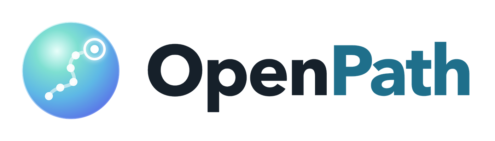
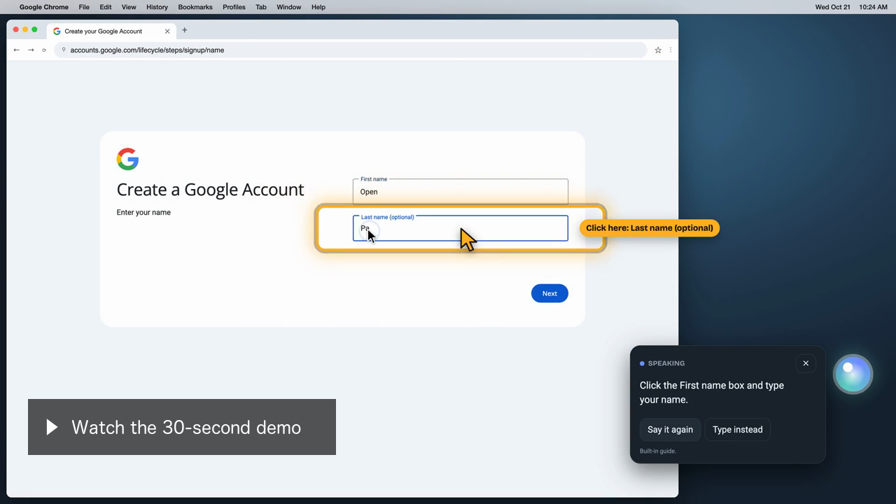

<p align="center"></p>

<p align="center"><b>A voice helper for older adults that shows the way, one step at a time.</b></p>

OpenPath is a glowing circle that floats on top of whatever is on the screen. Press **Ctrl+O** (or tap the circle) and say what you are trying to do. OpenPath answers out loud with one clear step, points at the exact box or button with a glowing ring, and moves to the next step when you have done it. It only tells and points: it never clicks, types or opens anything for you.

It answers questions with Claude, listens and speaks on your computer, works in English, Spanish, Chinese and Hindi, and refuses to help with scams.

## Demo

[](https://github.com/nathans3/OpenPath/raw/main/demo/openpath-demo.mp4)

[Watch the demo](https://github.com/nathans3/OpenPath/raw/main/demo/openpath-demo.mp4) (30 seconds). A grandpa asks "How do I make a Google account?" and OpenPath guides the sign-up. There is also a [version with a gap for your own voice](https://github.com/nathans3/OpenPath/raw/main/demo/openpath-demo-your-voice.mp4), where your question goes at 1.4 seconds.

The demo is recorded from a re-creation of Google's pages, with OpenPath's real circle, answer box, pointer and voice on top. The spoken steps are shortened to fit 30 seconds. It is not footage of a live sign-up; say so if anyone asks.

## What it does

**Signing up for a Google account** is the job it does best. Ask "How do I make a Google account?" and OpenPath follows Google's real sign-up on your real screen:

- It recognizes each Google page as it appears: Google's home page, sign-in, "Create account", name, birthday, Gmail address, password, phone check, code, recovery email, review and terms. Google sometimes skips or adds pages, and OpenPath follows whichever one shows.
- It goes one box at a time. It says only the current step ("Click the First name box and type your first name"), rings that box, and moves on once the box holds an answer, you press Enter, or you pick from a list (Month, Gender).
- If you land on a page that is not part of the sign-up, it tells you how to go back and labels the Back arrow and the address bar.
- "Say that again" repeats the current step.

**Other built-in guides:** Google Docs (new document tab, new document, share), Gmail (write an email), browser tabs, undo, copy and paste, bigger text, volume.

**Any other question:** Claude answers, and can look at a picture of the screen (with permission) to point at the right button.

**Scam protection:** fake virus warnings, prize ads, gift-card requests and "tech support" calls lock the screen red. OpenPath refuses and can alert a family member.

## Using it

| To | Do this |
|---|---|
| Ask a question | Press **Ctrl+O** from any app, or tap the circle, then talk. It stops listening on its own after a pause. |
| Stop it talking | Press Ctrl+O or tap the circle; it stops and listens. |
| Type instead | Press "Type instead" in the answer box. |
| Hear it again | Press "Say it again", or say "say that again". |
| Settings | Hover over the circle and press the gear. Tabs: Voice, Family, Account, Setup, History, Costs. |

## Install

### Mac

You need macOS 14 (Sonoma) or later, [Node.js](https://nodejs.org) 20 or later, and the Xcode Command Line Tools (`xcode-select --install`), which build OpenPath's small screen-reading helper.

```bash
git clone https://github.com/nathans3/OpenPath.git
cd OpenPath
npm install
npx electron-builder --mac dir --arm64 --publish never
open release/mac-arm64/OpenPath.app
```

The first time, allow these in System Settings → Privacy & Security:

| Permission | Why |
|---|---|
| Microphone | Hears your question after Ctrl+O or a tap |
| Screen & System Audio Recording | Reads the screen to know the page and where to point |
| Accessibility | Notices your clicks and the Enter key so it can move to the next step, and finds the browser's Back arrow |

The app is not signed yet, so macOS may treat each new build as a new app. If clicks or Enter stop working after an update, switch OpenPath off and on again under Accessibility.

### Claude key

OpenPath answers anything beyond its built-in guides with Claude. Add a key once in Settings → Setup (create one at console.anthropic.com). The key is encrypted on the computer and never shown again. Without a key, only the built-in guides answer. Before launch, this should move to an OpenPath server so customers never handle a key.

### Windows

```bash
npm run dist:win
```

The Windows build runs the circle, voice, Claude answers and Claude's pointing. Reading the screen on the computer (for the built-in guides) is macOS only for now.

## How it answers

- The Google sign-up guide and the other built-in guides answer instantly on the computer, without calling Claude.
- For everything else, Claude Haiku 5.5 answers first. OpenPath checks that the button it names is really on the screen. Claude Sonnet 5.5 answers only when that check fails, up to 300 times a month per user.
- OpenPath never uses Anthropic's "Covered Models" (Fable, Mythos), which must keep data for 30 days.
- Listening uses Whisper on the computer. The voice is Kokoro on the computer for English, Spanish and Hindi, and the computer's own voice for Chinese.

## Privacy and security

- **Where data goes:** only to Claude (api.anthropic.com), and only after passwords, card numbers, codes, dates of birth and emails are removed, including from earlier questions in the conversation. The app blocks every other connection from both its windows and its main process. App parts (speech models, libraries, fonts) download once, then load from the computer.
- **The microphone** turns on only after Ctrl+O or a tap, and stops on its own. Speech becomes words on the computer and is never saved or sent.
- **Clicks and keys:** with the Accessibility permission, OpenPath notices clicks near the box it points at and whether Enter was pressed. It never looks at, keeps or sends any other key.
- **Screen pictures** go to Claude only with permission, never on bank, health or password pages, and are never saved.
- **What is stored:** settings in `openpath-settings.json` (owner-only), with the Claude key encrypted by the operating system (Keychain on Mac, DPAPI on Windows), plus downloaded speech models. Conversations and answers stay in memory and disappear when OpenPath quits.
- **Delete all my data** in Settings → Setup removes everything personal from the computer.
- **App hardening:** windows run sandboxed with no Node access, may only use the microphone, cannot open pop-ups or leave the app's own pages, and never receive the Claude key.

The guards are in `electron/services/privacy.js`, `offline.js` and `store.js`, and `app/js/guardrails.js`.

## Price and costs

7-day free trial, then **$7.99 a month**, one plan with nothing sold on top, plus an optional one-time **$29** setup.

| User | Questions a day | Cost to us per month | Margin |
|---|---|---|---|
| Light | 2 | $0.70 | 91% |
| Average | 8 | $1.04 | 87% |
| Frequent | 20 | $1.72 | 78% |
| Heavy | 40 | $2.23 | 72% |

Card fees are $0.59 of each payment; the rest is Claude. Listening and voices cost nothing. The team's cost analysis and privacy documents have the details (ask Steven for access).

## Speed

A small always-running helper (`electron/native/ocr-helper.swift`, built on `npm install`) captures and reads the screen with ScreenCaptureKit and Vision, leaving OpenPath's own windows out of the picture.

| Check | Time |
|---|---|
| Notice the page changed | about 0.06 s |
| Recognize which page is showing | about 0.33 s |
| Find the box or button to point at | about 0.35 s |

## How it is built

Electron 33 with plain ES modules (no bundler), so you can edit a file and reload.

```
electron/
  main.js            the transparent always-on-top overlay window, tray, Ctrl+O hotkey, IPC
  preload.js         the only bridge between the windows and the computer
  native/
    ocr-helper.swift screen capture and text reading (ScreenCaptureKit + Vision), browser parts
  services/
    anthropic.js     Claude: Haiku first, Sonnet when needed, in-memory answer cache
    vision.js        finds words on screen, reads regions, reads the browser's web address
    follow.js        notices when a step is done: screen changes, clicks, Enter, list picks
    offline.js       what the windows may download; everything else is blocked
    privacy.js       network guard, window lockdown, private temp folder, delete-all
    store.js         settings, with the Claude key encrypted
    stt.js           stub: listening stays on the computer
app/
  overlay.html       the circle, answer box, pointer and settings (desktop)
  index.html         web preview
  lab.html           practice screens (OPENPATH_LAB=1 npm start)
  js/
    app.js           the overlay: listening, answering, the page-aware guide runner
    guides.js        page-aware guides for real websites (Google sign-up), one step at a time
    knowledge.js     built-in step-by-step guides in English, Spanish, Chinese, Hindi
    engine.js        request pipeline: redact → scam check → guides → Claude → fallback
    guardrails.js    redaction and scam scoring
    speech.js        Whisper listening, Kokoro and system voices
    circle.js        the circle and answer box
    pointer.js       the glowing ring, arrow and "Click here" label
    sidebar.js       settings tabs
    i18n.js          languages and interface words
demo/
  openpath-demo.mp4  the 30-second demo (and a version with a gap for your voice)
  video/             scripts that record the demo
brand/               logo, app icon and colors
```

## For developers

| Command | What it does |
|---|---|
| `npm start` | Run OpenPath from the code |
| `OPENPATH_LAB=1 npm start` | Also open the practice screens |
| `npm run web` | Web preview at http://localhost:5173 |
| `npm run dist:mac` / `npm run dist:win` | Build the app |
| `npm run build-helper` | Rebuild the Mac screen-reading helper |
| `npm run demo-voices` then `npm run demo-video-30s` | Re-record the demo video |
| `npm run demo-add-voice -- ~/Desktop/question.m4a` | Put your own question into the demo |

**Debug log:** start the app with logging to see one `[guide]` line per page, step and signal (never what was typed):

```bash
open -a "$PWD/release/mac-arm64/OpenPath.app" --stderr /tmp/openpath.log --args --enable-logging=stderr
```

## Before launch

- [ ] Run Claude through an OpenPath server with one company key, and ask Anthropic for zero data retention.
- [ ] Sign and notarize the Mac app (Apple Developer Program) and sign the Windows installer.
- [ ] Read the screen on Windows, so the built-in guides work there too.
- [ ] Publish a plain-language privacy policy, and have a lawyer review state privacy laws.
- [ ] Check the license of espeak-ng (GPL-3.0), used for Spanish and Hindi pronunciation. OpenPath downloads it at run time instead of bundling it.
- [ ] Choose a license for this repository.
