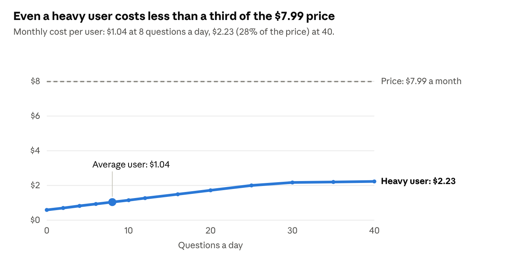
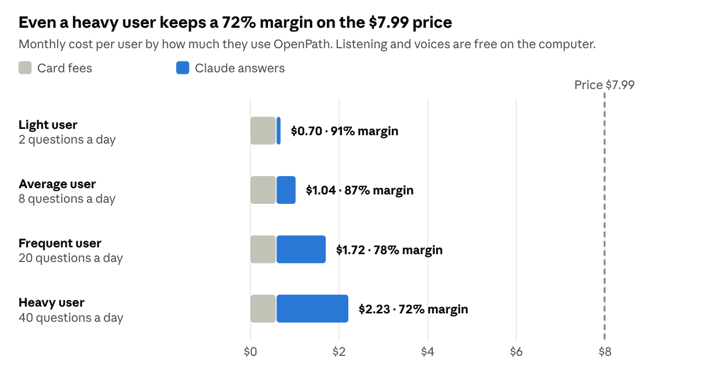

# OpenPath Cost Analysis

Oct 17, 2026 · @Steve

> Copied from the team's Claude Doc on October 18, 2026. Charts are pictures of the live ones.

## Bottom line

At **$7.99 a month**, an average user costs us **$1.04**, an **87% gross margin**. A heavy user who asks 40 questions a day costs $2.23, still a 72% margin.

Every answer comes from Claude, cheapest model first. Claude Haiku 5.5 answers, and OpenPath checks that the button it names is really on the screen. Claude Sonnet 5.5 answers only when that check fails, up to 300 times a month. The Google sign-up guide and the other built-in guides answer without calling Claude. Listening and the voice run on the user's computer and cost nothing. There is one plan at $7.99, actwith nothing sold on top.

Paying yearly, or by bank transfer, cuts the card fee and raises the margin to **90% or 93%**.

## What each part costs

| Part | Runs on | Cost per user per month |
| --- | --- | --- |
| Answers (Claude Haiku 5.5, Sonnet 5.5 when needed) | Anthropic | $0.45 |
| Listening (Whisper small) | User's computer | $0 |
| Voices (Kokoro for English, Spanish and Hindi; the computer's own voice for Chinese) | User's computer | $0 |
| Reading the screen and pointing | User's computer | $0 |
| Built-in guides and scam protection | User's computer | $0 |
| Speech models and fonts (downloaded once) | Hugging Face and Google Fonts, free | $0 |
| Card processing (Stripe, 2.9% + $0.30, plus 0.7% Billing) | Stripe | $0.59 |
| **Total, average user** |  | **$1.04** |

## Cost as use grows

*Modelled from the assumptions below · October 2026 prices · Card fees: Stripe 2.9% + $0.30 plus 0.7% Billing*

Cost climbs slowly with questions, because most answers come from the cheap Haiku model. The allowance of 300 Sonnet answers a month flattens it near $2.23.

## Where each dollar goes

*Modelled from the assumptions below · October 2026 prices*

Claude is the largest cost, and the card fee comes next. How people pay changes the card fee most. One yearly charge spreads the $0.30 fixed fee over 12 months, and a bank transfer replaces the 2.9% card rate with 0.8%.

## Fixed costs and break-even

The yearly costs of shipping the app are covered by **3 subscribers**. At $7.99 a month, each average subscriber contributes $6.95 a month, or $83.40 a year.

| Fixed cost | Per year | Why |
| --- | --- | --- |
| Apple Developer Program | $99 | Signs and notarizes the Mac app, so seniors can open it without a security warning |
| Windows signing (Azure Artifact Signing, Basic) | $119.88 | $9.99 a month; signs the Windows installer |
| Hosting downloads (GitHub Releases) | $0 |  |
| **Total** | **$218.88** |  |

The one-time $29 setup fee loses $1.14 to card processing, leaving $27.86.

## Assumptions and what changed

The first analysis put an average user at $1.85 a month on a $15 price, because the voice was a paid service and every answer used an expensive model. The voice now runs free on the computer, and answers try the cheap model first, so the price can drop to $7.99 and keep an 87% margin.

| Plan at $7.99 a month | Cost per user | Margin |
| --- | --- | --- |
| Paid monthly by card, average user (8 questions a day) | $1.04 | 87% |
| Paid monthly by card, heavy user (40 questions a day) | $2.23 | 72% |
| Paid yearly by card ($95.88 once a year), average user | $0.76 | 90% |
| Paid monthly by bank transfer (ACH), average user | $0.57 | 93% |

The figures assume:

- About 2 spoken replies per question, and 60% of replies needing AI (the rest come from built-in guides).
- A Claude Haiku 5.5 answer costs about $0.00017, and a Claude Sonnet 5.5 answer about $0.0047, averaging plain answers and answers with a screen picture.
- Haiku's answer is used 70% of the time. Sonnet answers the other 30%, up to 300 a month.
- Card fees: 2.9% + $0.30 per card charge plus 0.7% for Stripe Billing. Bank transfer (ACH): 0.8% plus 0.7% Billing.

## Next steps

- [ ] Join the Apple Developer Program, so the Mac app opens without a security warning.
- [ ] Offer yearly billing ($120 once a year) and bank transfer at checkout to cut the card fee.
- [ ] Measure in a pilot how often Haiku's answers pass the on-screen check; 70% is an estimate.
- [ ] Confirm the Stripe, Apple and Microsoft prices on their own pages before budgeting.

## Sources

Prices come from search results summarizing these pages, not from the official pages themselves. Claude prices are from Anthropic's model price list as of October 2026.

- [Stripe fee breakdown, 2026](https://flexprice.io/blog/stripe-pricing-breakdown-2026)
- [Apple Developer Program, free vs paid](https://flaviocopes.com/apple-developer-free-vs-paid/)
- [Azure Artifact Signing tiers (Microsoft Learn)](https://learn.microsoft.com/en-us/azure/trusted-signing/how-to-change-sku)
