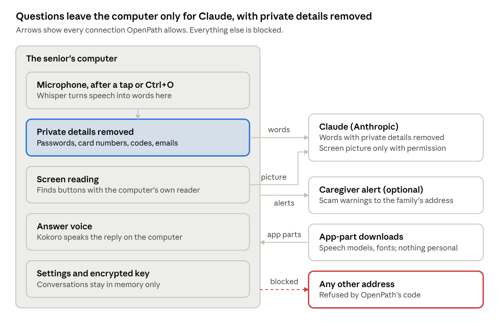

# OpenPath Privacy and Data

Oct 17, 2026 · @Steve

> Copied from the team's Claude Doc on October 18, 2026. The diagram is a picture of the live ones.

**The one line:** OpenPath helps, then forgets. Questions go only to Claude, with private details removed, and nothing else leaves the computer.

## Three things to say

1. **It only listens when you ask.** The microphone turns on when you tap the circle or press Ctrl+O. It never listens in the background.
2. **Private details never leave.** Passwords, card numbers and codes are removed before anything goes to Claude. Every other connection is blocked.
3. **Nothing is saved.** Conversations disappear when OpenPath closes. One button deletes everything.

## Where data goes

*OpenPath data flow · every allowed connection*

Listening, screen reading and the answer voice never leave the computer. Claude gets only words with private details removed, plus a screen picture if the person allows it.

## If someone asks

| Question | Short answer |
| --- | --- |
| Does it record me? | No. Speech becomes words on the computer, and the recording is thrown away. |
| Can it see my bank account? | It never sends a screen picture while a bank, health or password page is open. |
| Does Anthropic keep my questions? | They are deleted within 30 days and never used for training. Before launch, we will ask Anthropic to keep nothing at all. |
| Can it click or buy things for me? | No. It only talks and points. |
| How do you know it works? | We tested it. Other connections are blocked, and the key is encrypted. |

Full details, tests and sources are in [Details](#details) below.

---

## Details

The full record behind the talk track: what is stored, every safeguard, the tests, and what to settle before launch.

### What is stored on the computer

Only settings and downloaded app parts are written to disk. Everything about a conversation lives in memory and is gone when OpenPath quits.

| What | Where | What it holds | How long |
| --- | --- | --- | --- |
| Settings file | OpenPath's folder (on a Mac: Library/Application Support/OpenPath) | Language, voice choices, caregiver name, phone and alert address, trial dates, counts of Claude calls | Until changed or deleted. Readable only by the computer's user account |
| Claude key | Inside the settings file | The key, encrypted by the operating system (Keychain on Mac, DPAPI on Windows) | Until "Forget key" or "Delete all my data". Never shown again after saving |
| Speech models, libraries, fonts | OpenPath's "offline" folder | App parts only, no personal data | Kept so they are not downloaded again |
| Screen picture (rare fallback) | A private temporary folder | One picture, only when the fast screen reader is unavailable | Deleted right after reading. The folder is emptied at every start and quit |
| Conversation | Memory only | The last 40 lines, with private details already removed | Until OpenPath quits or "Clear history" |
| Recent answers | Memory only | Up to 200 answers, so a repeat question is instant | Until OpenPath quits |
| Voice recordings | Memory only | The seconds after a tap or Ctrl+O | Discarded as soon as they are turned into words |

### Safeguards built into the app

- **Private details removed first.** Passwords, Social Security numbers, card numbers, account numbers, one-time codes, dates of birth and email addresses are replaced with placeholders before any words reach Claude. This also covers earlier questions sent along as context, and the caregiver alert.
- **Only Anthropic.** The part of the app that calls Claude can connect to api.anthropic.com and nothing else.
- **Windows locked down.** OpenPath's windows may only download their own parts (speech models, libraries, fonts) and send the caregiver alert the family set up. Every other web request and live connection is blocked.
- **Microphone only on purpose.** It turns on only after a tap on the circle or Ctrl+O, stops after a pause or 20 seconds, and never listens in the background. The windows get the microphone and no other permission.
- **Clicks and the Enter key, nothing else.** With the person's Accessibility permission, OpenPath notices clicks near the box it is pointing at and whether the Enter key was pressed, so it can move to the next step. It never looks at, keeps or sends any other key, so what the person types is never recorded.
- **Screen pictures need permission.** Claude sees a picture of the screen only after the person allows it once, never when a bank, health or password page is in front, and the picture is never saved.
- **Encrypted key.** The Claude key is encrypted by the operating system and is never handed to the windows that show the interface.
- **Sandboxed windows.** The interface has no access to the computer's files or programs, cannot open pop-ups, and cannot leave OpenPath's own pages.
- **No models that must keep data.** OpenPath never uses Anthropic's "Covered Models" (Fable, Mythos), which must keep data for at least 30 days.
- **Tell and point only.** OpenPath never clicks, types or opens anything for the person.
- **Scam guard.** Fake virus warnings, prize messages and gift-card requests lock the screen red, and OpenPath refuses to help.
- **Delete all my data.** One button removes everything personal from the computer.

The guards live in electron/services/privacy.js, offline.js and store.js, and app/js/guardrails.js.

### Proof

Each check ran on 2026-10-17 against OpenPath's own code, inside the Electron runtime the app ships with.

| Check | Result |
| --- | --- |
| Connect to google.com from the part that calls Claude | Blocked |
| Connect to api.anthropic.com | Allowed (reached Anthropic) |
| Save a test Claude key, then open the settings file | Key not readable; only an encrypted copy is stored |
| Read the key back inside the app | Matches the saved key |
| Settings file permissions | Owner only (600) |
| Temporary folder permissions | Owner only (700) |
| Put a file in the temporary folder, then run the start-up cleanup | Folder removed |
| Start the rebuilt app with sandboxed windows | Starts normally; listening and voice models load |

Anyone can check these again:

1. Open the settings file in a text editor. The key appears only as anthropicKeyEnc, a scrambled string.
2. Watch OpenPath's connections with a network monitor such as Little Snitch (Mac) or GlassWire (Windows). Questions go only to api.anthropic.com. The other connections are the app-part download sites (Hugging Face, jsDelivr, Google Fonts), which receive no personal data, and the caregiver alert if one is set up.
3. Read electron/services/privacy.js and offline.js. Together they list every allowed destination.

### What Anthropic keeps

Anthropic deletes API questions and answers within 30 days and does not train on them without permission. Content its safety systems flag can be kept up to 2 years. Zero data retention, where nothing is stored after the reply, must be arranged with Anthropic's sales team.

### Before launch

- [ ] Ask Anthropic for zero data retention on OpenPath's account.
- [ ] Run Claude through an OpenPath server holding one company key, so customers never handle a key.
- [ ] Publish a plain-language privacy policy based on this document.
- [ ] Have a lawyer review state privacy laws such as California's (CCPA). OpenPath is not a health app, so HIPAA should not apply, but confirm it.
- [ ] Check the license of espeak-ng (GPL-3.0), used for Spanish and Hindi pronunciation.
- [ ] Sign the Mac and Windows apps so the operating system confirms they come from OpenPath.

### Sources

- [How long do you store my organization's data? (Anthropic Privacy Center, July 1, 2026)](https://privacy.claude.com/en/articles/7996866-how-long-do-you-store-personal-data)
- [API and data retention (Claude Platform Docs)](https://platform.claude.com/docs/en/manage-claude/api-and-data-retention)
- [Covered Models (Claude Help Center, September 1, 2026)](https://support.claude.com/en/articles/15425695-covered-models)
